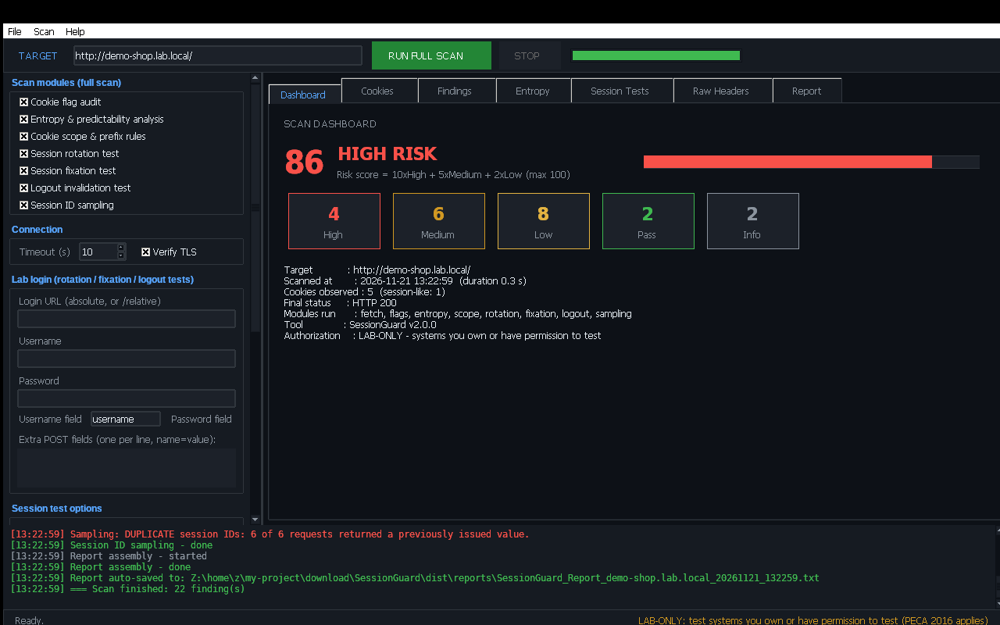

# SessionGuard v2.0

### Cookie & Web Session Security Analyzer

SessionGuard is a Windows-friendly security auditing tool designed to analyze cookie configurations and web session management in authorized test environments. It helps identify common weaknesses in session handling and generates a severity-rated security report.

The application includes a graphical user interface (GUI), command-line support, an offline demo mode, and a deliberately vulnerable local lab server for practice.

> **Use responsibly:** Only scan applications and systems that you own or have explicit permission to test.

---

## Features

- **Cookie Security Audit** — Checks `Secure`, `HttpOnly`, and `SameSite` attributes, including `SameSite=None` without `Secure`.
- **Session ID Analysis** — Measures session identifier length and Shannon entropy, and looks for weak or predictable patterns.
- **Session Rotation Testing** — Checks whether the session identifier changes after login.
- **Session Fixation Testing** — Tests whether a supplied session ID is retained during authentication.
- **Logout Invalidation Testing** — Checks whether a pre-logout session remains valid after logout.
- **Session ID Sampling** — Samples multiple identifiers to look for duplicates, collisions, shared prefixes, and sequential patterns.
- **Cookie Scope & Prefix Checks** — Reviews cookie Domain and Path scope and checks `__Host-` and `__Secure-` prefix requirements.
- **Security Findings & Reports** — Displays findings with severity ratings, evidence, remediation guidance, and OWASP references.
- **GUI and CLI** — Run scans through the desktop interface or command line.
- **Offline Demo & Self-Test** — Explore sample results and run built-in offline checks.
- **Included Practice Lab** — Use the bundled vulnerable lab application to learn how the checks work.

## Screenshots

The application screenshot is available in the package:



---

## Download

Download or clone this repository:

```bash
git clone https://github.com/wolfdefenders/SessionGuard.git
```

Alternatively, download the repository as a ZIP file from GitHub and extract it.

The Windows application files are located in the `SessionGuard/` directory.

## Quick Start (Windows)

1. Download and extract the repository ZIP.
2. Open the extracted `SessionGuard` folder.
3. Run **`INSTALL_SessionGuard.bat`** for the recommended setup, or double-click **`SessionGuard.exe`** to launch the application directly.
4. Enter the URL of your authorized test application.
5. Configure the optional login and session test settings.
6. Start the scan and review the results.

The bundled `SessionGuard.exe` is a standalone Windows application and does not require a separate Python installation.

### Included Windows files

| File | Description |
|---|---|
| `SessionGuard.exe` | Main standalone GUI application |
| `LabServer.exe` | Standalone vulnerable practice server |
| `INSTALL_SessionGuard.bat` | Installer and shortcut setup |
| `Run_SessionGuard.bat` | Launch helper |
| `Build_EXE.bat` | Rebuilds the executable from source |
| `HOW_TO_USE.txt` | Quick-start guide in Roman Urdu and English |

Keep the application files together when running the EXE. Reports are saved in a `reports/` folder alongside the application.

---

## Run from Source

### Requirements

- Windows, Linux, or macOS with Python 3.8+
- Tkinter (usually included with standard Windows Python installations)
- Python packages listed in `requirements.txt`

### Installation

Open a terminal in the `SessionGuard/` directory:

```bash
python -m pip install -r requirements.txt
```

### Launch the GUI

```bash
python SessionGuard_GUI.py
```

### Load demo data

```bash
python SessionGuard_GUI.py --demo
```

You can also use the application's **Help → Load Demo Data** menu option.

### Run self-tests

```bash
python SessionGuard_GUI.py --selftest
```

---

## Using the Application

1. Enter your authorized lab application's URL in the **Target** field.
2. Select the scan modules you want to run.
3. If you want to test authenticated session behavior, configure:
   - Login URL
   - Test username and password
   - Username and password POST field names
   - Optional extra POST fields, such as a CSRF token
4. Configure session cookie names and optional fixation, sampling, logout, and protected-page settings.
5. Click **RUN FULL SCAN**. Use **STOP** to abort a scan.
6. Review the dashboard, cookies, findings, entropy analysis, session tests, raw headers, and report tabs.
7. Save or copy the generated report when needed.

The application can save scan reports automatically in its `reports/` directory. The password is not saved in the application settings.

## Security Checks

| Check | What it examines |
|---|---|
| Cookie flags | `Secure`, `HttpOnly`, and `SameSite` attributes |
| Cookie transmission | Raw `Set-Cookie` headers captured across response hops |
| Session entropy | Length, Shannon entropy, and estimated total entropy |
| Predictability | Patterns such as sequential values and other weak identifiers |
| Session rotation | Whether the session ID changes after login |
| Session fixation | Whether a planted session ID is accepted or replaced |
| Logout invalidation | Whether the old session remains usable after logout |
| ID sampling | Duplicate IDs, collisions, shared prefixes, and sequential patterns |
| Cookie scope | Domain and Path configuration |
| Cookie prefixes | `__Host-` and `__Secure-` prefix requirements |

### Severity and Risk Score

SessionGuard assigns severity levels to findings and calculates a risk score using the following weighting:

```text
Risk Score = (10 × High) + (5 × Medium) + (2 × Low)
```

The score is capped at 100. Informational findings provide additional context and do not contribute to this formula.

A finding's severity depends on the evidence collected during the scan. Some tests require valid lab login details and suitable application endpoints; inconclusive tests should not be treated as confirmed vulnerabilities.

---

## Practice with the Included Lab Server

The repository includes a deliberately vulnerable local application for learning and testing.

### Option 1: Use the standalone server

1. Open the `SessionGuard/` directory.
2. Double-click `LabServer.exe`.
3. The local practice server should be available at:

```text
http://127.0.0.1:5057/
```

4. Enter that address as the target in SessionGuard.

**Demo credentials:**

```text
Username: testuser
Password: TestPass123
```

### Option 2: Run the lab from Python source

Install the dependencies, then run:

```bash
python lab_server.py 5057
```

The lab server is intentionally vulnerable. It is provided for local educational use, not for production deployment or exposure to public networks.

---

## Command-Line Usage

SessionGuard also supports command-line scans.

Example:

```bash
python SessionGuard_GUI.py http://127.0.0.1:5057/ \
  --login-url /login \
  --username testuser \
  --password TestPass123 \
  --samples 10 \
  --out lab_report.txt
```

To see all available options:

```bash
python SessionGuard_GUI.py --help
```

To run the built-in self-tests:

```bash
python SessionGuard_GUI.py --selftest
```

The standalone Windows executable can also be used for command-line scans. Refer to `HOW_TO_USE.txt` for Windows-specific examples.

---

## Project Structure

```text
SessionGuard-main/
├── LICENSE
├── README.md
└── SessionGuard/
    ├── SessionGuard.exe
    ├── LabServer.exe
    ├── SessionGuard_GUI.py
    ├── lab_server.py
    ├── INSTALL_SessionGuard.bat
    ├── Run_SessionGuard.bat
    ├── Build_EXE.bat
    ├── HOW_TO_USE.txt
    ├── requirements.txt
    ├── icon.ico
    ├── icon.png
    ├── screenshot.png
    ├── sample_report.txt
    └── version.txt
```

---

## Troubleshooting

**The GUI does not open**
- Try launching `SessionGuard.exe` directly from the extracted `SessionGuard/` folder.
- Keep the EXE and its accompanying package files together.
- Check whether Windows Security or another antivirus has quarantined the executable.

**Login tests are inconclusive**
- Verify the test credentials and login URL.
- Check the username and password field names.
- Add any required CSRF token or other fields under extra POST fields.
- Configure a protected URL and authenticated-page marker if needed for logout testing.

**No cookies are detected**
- Try a lab page or endpoint that actually sends `Set-Cookie` headers.
- Check that the target URL is correct.

**TLS certificate errors in a test lab**
- For a self-signed certificate in your own lab, you can disable TLS verification in the application settings. Do not disable certificate verification when testing real production services.

**Windows SmartScreen warning**
- Windows may warn about an unsigned executable. Only run it if you trust the source and have verified the download.

---

## Responsible Use

SessionGuard is intended for education, defensive security auditing, and authorized testing.

- Scan only systems you own or have explicit permission to assess.
- Use test accounts and test session data.
- Prefer isolated local lab environments.
- Do not attempt to access, reuse, or manipulate another person's session.
- Do not expose the intentionally vulnerable lab server to the public internet.

You are responsible for complying with applicable laws and obtaining authorization before testing any system.

## License

This project is licensed under the **MIT License**. See the [LICENSE](LICENSE) file for details.

---

<p align="center">
  <b>SessionGuard v2.0</b><br>
  Cookie & Web Session Security Analyzer<br>
  <a href="https://github.com/wolfdefenders/SessionGuard">GitHub Repository</a>
</p>
